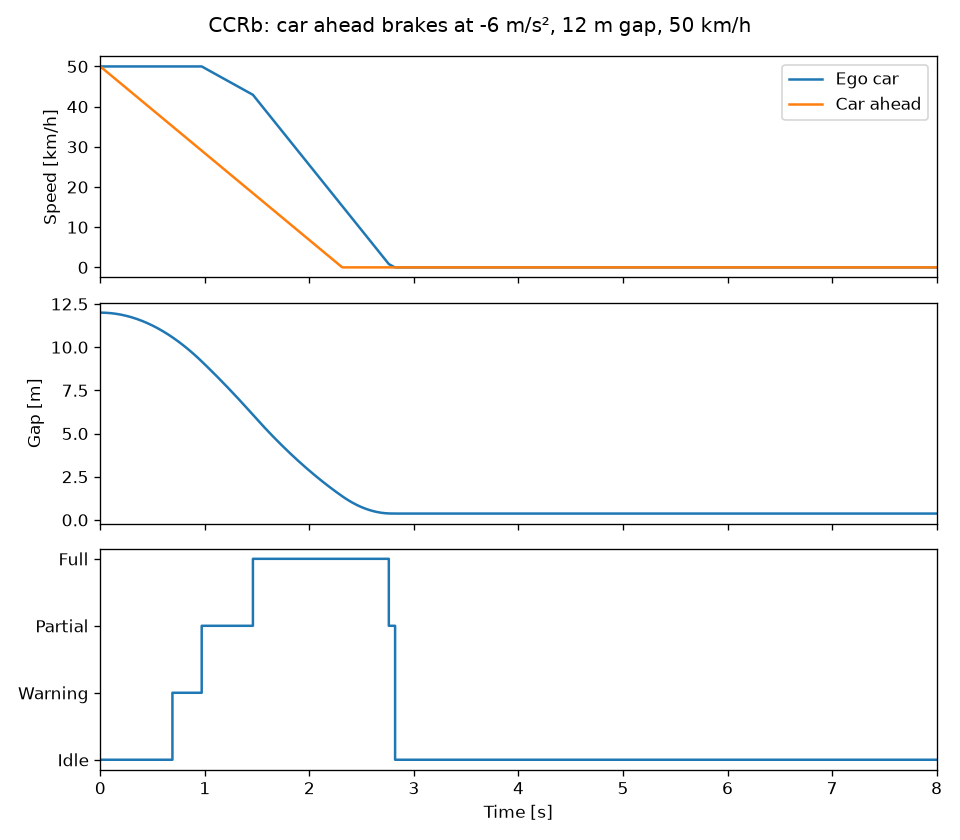
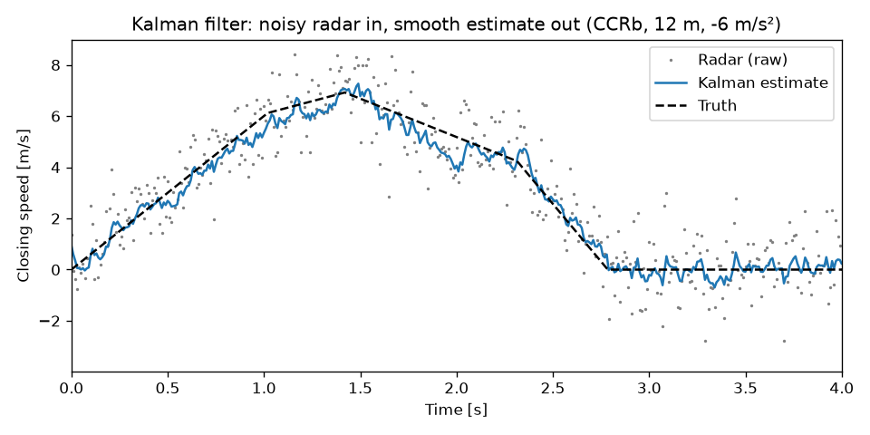

# ADAS-AEB: Automatic Emergency Braking in C++17


A simulator of **Forward Collision Warning (FCW)** and **Automatic Emergency
Braking (AEB)**, the car safety feature that warns the driver and brakes by
itself to avoid hitting the car ahead.

> **Status: complete.** Built test-first: 36 unit tests (GoogleTest), zero
> compiler warnings (`-Wall -Wextra -Wpedantic -Werror`), CI on every push.



*The car ahead brakes hard 12 m in front. The system warns at 0.7 s, brakes
partially at 1.0 s and fully at 1.45 s, and stops 37 cm short.*

## How it works

1. **Vehicle model:** each car moves with constant-acceleration physics.
   A braking car stops at zero speed and never rolls backwards.
2. **Time-to-collision (TTC):** seconds until impact if nothing changes:
   `gap / closing speed`. Infinity when not closing in, 0 when already touching.
3. **Decision logic:** TTC thresholds pick the action:

   | TTC         | Action        |
   |-------------|---------------|
   | > 2.6 s     | Nothing       |
   | ≤ 2.6 s     | Warn driver   |
   | ≤ 1.6 s     | Partial brake |
   | ≤ 0.9 s     | Full brake    |

4. **Hysteresis and brake hold:** braking starts immediately, but only eases
   off once TTC is clearly safe again. Once braking, it never fully releases
   while the car is still closing in, so it brakes all the way to a stop.
5. **Noisy radar + Kalman filter:** the sensor model adds random error to
   every reading. A Kalman filter combines the readings with physics to
   estimate the true gap and closing speed before the AEB decides.

## Euro NCAP results

Simulated against the Euro NCAP rear-end tests used to rate new cars
(start distance = 4 s before impact):

- **CCRs:** car ahead is standing still
- **CCRm:** car ahead drives slowly at 20 km/h
- **CCRb:** both at 50 km/h, then the car ahead brakes hard

| Test | Speeds | Result |
|------|--------|--------|
| CCRs | 10–70 km/h | Avoided all 7 |
| CCRs | 80 km/h | Hit at 24 km/h (speed cut by 70%) |
| CCRm | 30, 50, 80 km/h | Avoided all 3 |
| CCRb | 12 / 40 m gap, −2 / −6 m/s² | Avoided all 4 |

**14 of 15 avoided.** At 80 km/h, full braking at TTC 0.9 s starts too late
to stop completely, so the crash is only softened. Run `./build/ncap` to reproduce.

## Noisy radar and phantom braking

A real radar is never exact. With noise added (σ = 0.2 m on distance,
1 m/s on closing speed), the AEB reacts to single bad readings and brakes for
no reason: **phantom braking**. Tested on the same 15 Euro NCAP scenarios plus
20 calm drives in queue traffic (5 m behind, both at 20 km/h):

| Sensor | Euro NCAP avoided | Phantom brakes in calm traffic |
|--------|-------------------|--------------------------------|
| Perfect sensor | 14/15 | 0/20 |
| Noisy radar | 14/15 | **17/20** |
| Noisy radar + Kalman filter | 14/15 | **0/20** |



The filter is tuned as a trade-off: smoothing more removes noise but reacts
later. A slower setting crashed in the hardest test (CCRb, 12 m gap, −6 m/s²),
so the chosen tuning favours reacting fast, and some wiggle remains.

## Known limitations

- Brakes act instantly. Real brakes need ~0.2 s to build pressure.
- No standstill hold: after stopping, a real car would need to keep the brake on.
- Radar noise is a simple bell curve. Real radars also see ghost objects
  (bridges, manhole covers), a common real-world cause of phantom braking.

## Roadmap

- [x] CMake + GoogleTest setup
- [x] Vehicle kinematics with braking clamp
- [x] Time-to-collision with edge cases (collision, equal speed, lead faster)
- [x] Threshold-based warn / brake decision
- [x] Hysteresis so sensor noise can't make the brakes flicker
- [x] Euro NCAP rear-end scenarios (CCRs, CCRm, CCRb) with pass/fail
- [x] Plots of speed, gap and AEB state over time
- [x] Noisy radar + Kalman filter
- [x] GitHub Actions CI

## Build and test

Requires CMake ≥ 3.20 and a C++17 compiler.

```bash
cmake -S . -B build
cmake --build build
ctest --test-dir build --output-on-failure
```

To regenerate the plots (Python 3):

```bash
./build/ncap                       # writes trace.csv and radar.csv
pip install -r requirements.txt
python plot.py                     # writes docs/aeb_ccrb.png and docs/kalman.png
```
